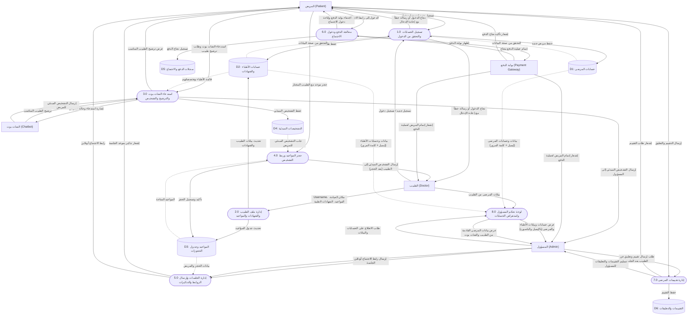
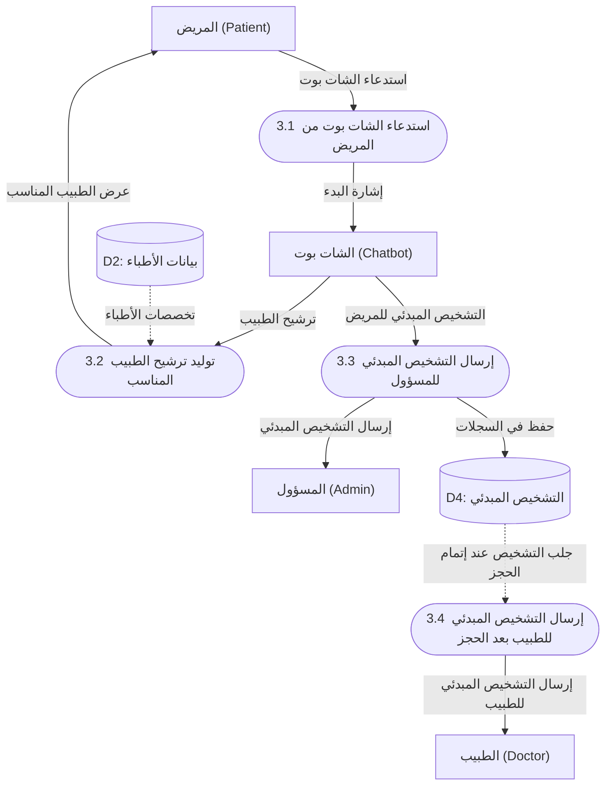
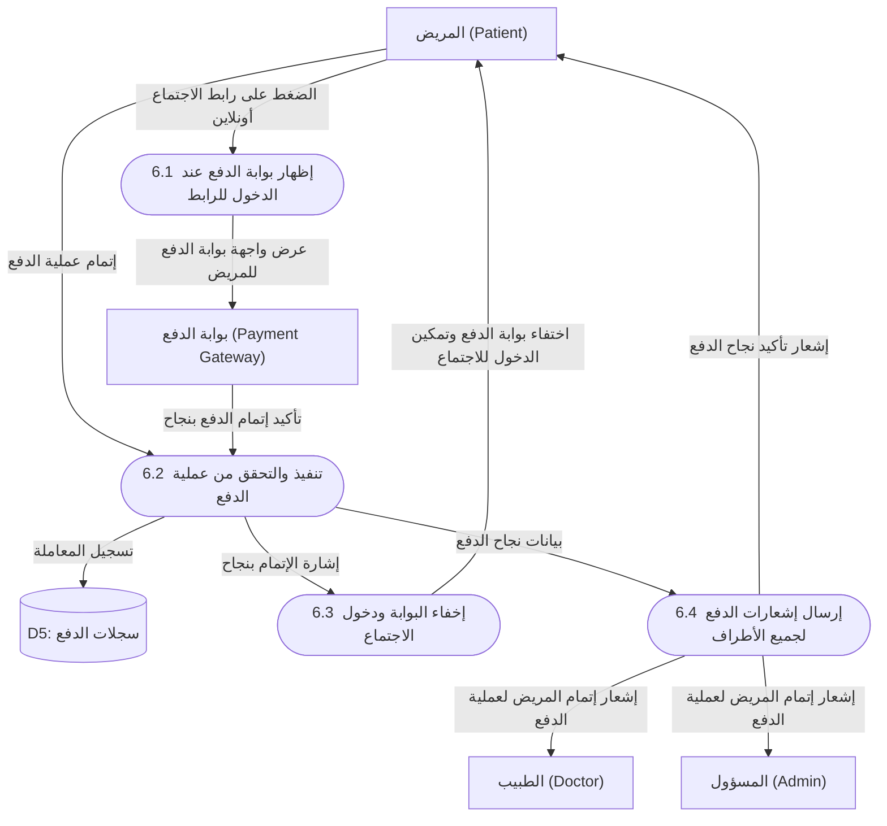

# مخططات تدفق البيانات (DFD) - مطابقة 100% لمتطلبات النظام

تعتمد هذه المخططات بدقة تامة على **الكيانات الخمسة** والتدفقات المذكورة في نص المتطلبات حرفياً:
1. **المريض (Patient)**
2. **المسؤول (Admin)**
3. **الشات بوت (Chatbot)**
4. **الطبيب (Doctor)**
5. **بوابة الدفع (Payment Gateway)**

---

## 1. مخطط السياق العام (Context Diagram - Level 0)

يوضح النظام كمركز رئيسي تتصل به الأطراف والكيانات الخمسة وفق الشروط والتدفقات المحددة بدقة.

```mermaid
flowchart TD
    %% Entities
    Patient["المريض (Patient)"]
    Admin["المسؤول (Admin)"]
    Chatbot["الشات بوت (Chatbot)"]
    Doctor["الطبيب (Doctor)"]
    Payment["بوابة الدفع (Payment Gateway)"]

    %% Main System
    System(["0.0 نظام المنصة والعيادة الطبية"]):::sysClass

    %% Patient Flows
    Patient -->|"1. بيانات تسجيل حساب جديد"| System
    Patient -->|"2. تسجيل الدخول (بريد وكلمة مرور)"| System
    System -->|"3. رد الدخول: بنجاح / رسالة خطأ وإعادة إدخال"| Patient
    Patient -->|"4. طلب حجز موعد مع طبيب"| System
    Patient -->|"5. استدعاء الشات بوت لترشيح طبيب"| System
    System -->|"6. ترشيح الطبيب المناسب للحالة"| Patient
    System -->|"7. إشعار تذكير بموعد الجلسة (من المسؤول)"| Patient
    System -->|"8. رابط الاجتماع أونلاين (من المسؤول)"| Patient
    System -->|"9. طلب إرسال تقييم وتعليق (من المسؤول)"| Patient
    Patient -->|"10. إرسال تقييم وتعليق عن الطبيب"| System
    Payment -->|"11. إشعار تأكيد نجاح عملية الدفع"| Patient

    %% Doctor Flows
    Doctor -->|"1. بيانات تسجيل حساب جديد"| System
    Doctor -->|"2. تسجيل الدخول (بريد وكلمة مرور)"| System
    System -->|"3. رد الدخول: بنجاح / رسالة خطأ وإعادة إدخال"| Doctor
    Doctor -->|"4. بيانات الطبيب: البريد، كلمة المرور، المواعيد، Username، العيادة"| System
    Doctor -->|"5. إضافة بيانات أخرى (الشهادات الطبية)"| System
    Doctor -->|"6. إرسال بيانات المرضى إلى المسؤول"| System
    System -->|"7. التشخيص المبدئي للمريض (بعد الحجز من الشات بوت)"| Doctor
    Payment -->|"8. إشعار إتمام المريض لعملية الدفع"| Doctor

    %% Chatbot Flows
    System -->|"1. إشارة استدعاء الشات بوت من المريض"| Chatbot
    Chatbot -->|"2. ترشيح الطبيب المناسب للمريض"| System
    Chatbot -->|"3. إرسال التشخيص المبدئي للمريض إلى المسؤول"| System
    Chatbot -->|"4. إرسال التشخيص المبدئي للطبيب (بعد حجز الموعد)"| System

    %% Admin Flows
    System -->|"1. بيانات المرضى (قادمة من الطبيب والشات بوت)"| Admin
    Admin -->|"2. طلب الاطلاع على الحسابات (البريد وكلمة المرور للمرضى والأطباء)"| System
    System -->|"3. عرض بيانات وحسابات الأطباء والمرضى مع كلمات المرور"| Admin
    Admin -->|"4. إرسال إشعار تذكير بموعد الجلسة للمريض"| System
    Admin -->|"5. إرسال رابط الاجتماع أونلاين للمريض"| System
    Admin -->|"6. طلب إرسال تقييم وتعليق من المريض"| System
    System -->|"7. تقييمات وتعليقات المرضى بعد انتهاء الجلسة"| Admin
    Payment -->|"8. إشعار إتمام المريض لعملية الدفع"| Admin

    %% Payment Gateway Flows
    Patient -->|"1. الدخول إلى رابط الاجتماع -> ظهور بوابة الدفع"| Payment
    Payment -->|"2. إتمام الدفع بنجاح -> اختفاء البوابة والسماح بدخول الاجتماع"| Patient

    classDef sysClass fill:#0f172a,stroke:#38bdf8,stroke-width:3px,color:#fff;
```

---

## 2. مخطط تدفق البيانات - المستوى الأول (DFD Level 1)

يقسم العمليات ومخازن البيانات استناداً إلى كل نقطة في نص المتطلبات:

### مخازن البيانات (Data Stores):
* **D1: حسابات وبيانات المرضى:** (البريد الإلكتروني، كلمة المرور، البيانات الشخصية).
* **D2: حسابات وبيانات الأطباء:** (البريد الإلكتروني، كلمة المرور، Username، مكان العيادة، المواعيد، الشهادات الطبية).
* **D3: الحجوزات والمواعيد:** (تفاصيل الحجز، تاريخ ووقت الجلسة، رابط الاجتماع أونلاين).
* **D4: التشخيصات وسجلات الشات بوت:** (التشخيص المبدئي الخاص بالمريض، ترشيحات الأطباء).
* **D5: المدفوعات والاجتماعات:** (حالة الدفع، إذن الدخول للاجتماع).
* **D6: التقييمات والتعليقات:** (تقييمات المرضى وتعليقاتهم عن الأطباء).

---

## 3. تفصيل العمليات الدقيقة (DFD Level 2)

### 3.1 تفصيل مسار الشات بوت والتشخيص المبدئي (Process 3.0)

---

### 3.2 تفصيل مسار بوابة الدفع ودخول الاجتماع (Process 6.0)

---

## 4. جدول مطابقة المتطلبات بالتدفقات (Requirements Traceability Matrix)

| البند في المتطلبات | الكيان أو الطرف | التدفق في المخطط | العملية المرتبطة |
| :--- | :--- | :--- | :--- |
| **1.1** | المريض | تسجيل حساب جديد | 1.0 تسجيل الحسابات |
| **1.2** | المريض | تسجيل الدخول -> نجاح أو رسالة خطأ وإعادة إدخال | 1.0 تسجيل الحسابات |
| **1.3** | المريض | حجز موعد مع طبيب أو محادثة الشات بوت لترشيح طبيب | 3.0 الشات بوت & 4.0 الحجز |
| **2.1** | المسؤول | الحصول على بيانات المرضى من الطبيب والشات بوت | 8.0 لوحة تحكم المسؤول |
| **2.2** | المسؤول | الاطلاع على حسابات الأطباء والمرضى (إيميل وكلمة مرور) | 8.0 لوحة تحكم المسؤول |
| **2.3** | المسؤول | إرسال إشعار تذكير بموعد الجلسة للمريض | 5.0 إدارة الجلسات |
| **2.4** | المسؤول | إرسال رابط الاجتماع أونلاين للمريض | 5.0 إدارة الجلسات |
| **2.5** | المسؤول | طلب إرسال تقييم وتعليق عن الطبيب بعد الجلسة | 7.0 إدارة التقييمات |
| **3.1** | الشات بوت | يظهر عندما يستدعيه المريض | 3.0 استدعاء الشات بوت |
| **3.2** | الشات بوت | إرسال التشخيص المبدئي للمريض إلى المسؤول | 3.0 استدعاء الشات بوت |
| **3.3** | الشات بوت | إرسال التشخيص المبدئي للطبيب بعد حجز الموعد | 4.0 حجز المواعيد |
| **4.1** | الطبيب | تسجيل حساب جديد | 1.0 تسجيل الحسابات |
| **4.2** | الطبيب | تسجيل الدخول -> نجاح أو رسالة خطأ وإعادة إدخال | 1.0 تسجيل الحسابات |
| **4.3** | الطبيب | بيانات: الإيميل، الباسورد، المواعيد، Username، العيادة | 2.0 إدارة ملف الطبيب |
| **4.4** | الطبيب | إضافة بيانات أخرى مثل الشهادات الطبية بعد الدخول | 2.0 إدارة ملف الطبيب |
| **5.1** | بوابة الدفع | تظهر عند الدخول لرابط الاجتماع أونلاين | 6.0 معالجة الدفع |
| **5.2** | بوابة الدفع | بعد إتمام الدفع بنجاح: تختفي البوابة ويدخل الاجتماع | 6.0 معالجة الدفع |
| **5.3** | بوابة الدفع | ترسل إشعاراً للطبيب والمسؤول بإتمام المريض للدفع | 6.0 معالجة الدفع |
| **5.4** | بوابة الدفع | ترسل إشعاراً للمريض بتأكيد نجاح عملية الدفع | 6.0 معالجة الدفع |
